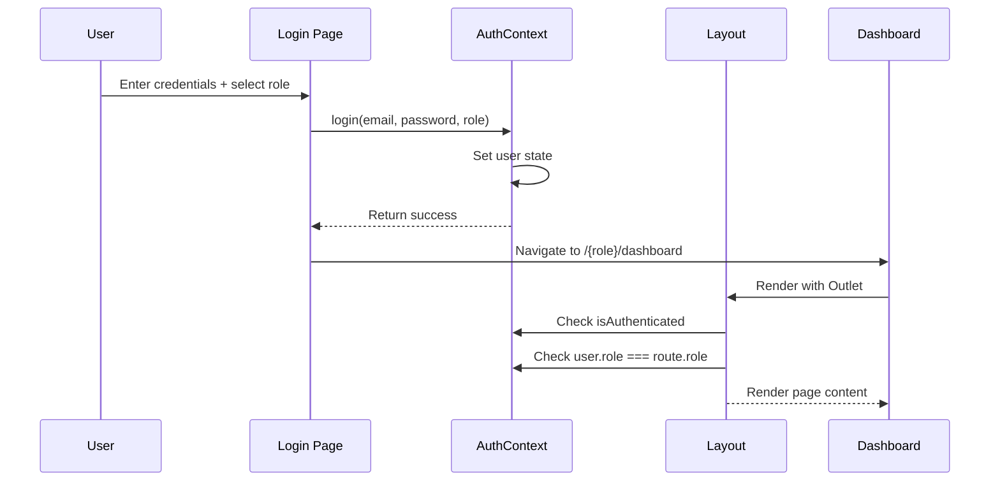

# 📚 SMMS - Student Mentoring Management System

## Complete Project Documentation with Routing Guide

---

## 🎯 Project Overview

**SMMS (Student Mentoring Management System)** is a web-based platform designed to facilitate mentor-mentee relationships in educational institutions. It provides role-based dashboards for **Administrators**, **Mentors**, and **Students** to manage and track mentoring activities.

### Tech Stack
| Technology | Purpose |
|------------|---------|
| **React 18** | Frontend UI Library |
| **React Router DOM 6** | Client-side Routing |
| **Vite** | Build Tool & Dev Server |
| **Vanilla CSS** | Styling |

---

## 📁 Project Structure

```
SMMS/
├── index.html              # Root HTML file
├── package.json            # Project dependencies
├── vite.config.js          # Vite configuration
└── src/
    ├── main.jsx            # App entry point (renders to DOM)
    ├── App.jsx             # Main component with routing
    ├── index.css           # Global styles
    ├── context/
    │   └── AuthContext.jsx # Authentication state management
    ├── components/
    │   ├── Layout.jsx      # Main layout with sidebar & header
    │   ├── Sidebar.jsx     # Navigation menu (role-based)
    │   ├── Header.jsx      # Top header component
    │   ├── DataTable.jsx   # Reusable data table
    │   ├── Modal.jsx       # Reusable modal component
    │   └── StatsCard.jsx   # Dashboard statistics card
    └── pages/
        ├── Login.jsx       # Login page (public)
        ├── admin/
        │   ├── AdminDashboard.jsx
        │   ├── UserManagement.jsx
        │   └── AdminReports.jsx
        ├── mentor/
        │   ├── MentorDashboard.jsx
        │   ├── MenteeList.jsx
        │   ├── SessionManagement.jsx
        │   └── FeedbackRemarks.jsx
        └── student/
            ├── StudentDashboard.jsx
            ├── MentorInfo.jsx
            ├── StudentSessions.jsx
            └── StudentReports.jsx
```

---

## 🔀 Routing Architecture

### How Routing Works

1. **Entry Point**: `main.jsx` wraps the app with `<BrowserRouter>`
2. **Route Definitions**: `App.jsx` defines all routes using `<Routes>` and `<Route>`
3. **Layout Wrapper**: Protected routes are wrapped in `<Layout>` component
4. **Authentication**: `AuthContext` manages login state globally

### Route Flow Diagram

```mermaid
graph TD
    A[User] --> B{Is Authenticated?}
    B -->|No| C[/login]
    B -->|Yes| D{User Role?}
    D -->|Admin| E[/admin/*]
    D -->|Mentor| F[/mentor/*]
    D -->|Student| G[/student/*]
```

---

## 📍 Complete Route Table

### Public Routes (No Authentication Required)

| Path | Component | Description |
|------|-----------|-------------|
| `/` | `<Navigate to="/login">` | Redirects to login page |
| `/login` | `<Login />` | Login page for all users |

---

### 🔴 Admin Routes (`/admin/*`)

> **Access**: Only users with `role: 'admin'`

| Path | Component | Description |
|------|-----------|-------------|
| `/admin` | `<Navigate to="/admin/dashboard">` | Auto-redirect to dashboard |
| `/admin/dashboard` | `<AdminDashboard />` | Admin main dashboard with stats |
| `/admin/users` | `<UserManagement />` | Manage all users (CRUD operations) |
| `/admin/reports` | `<AdminReports />` | System-wide reports & analytics |

**Sidebar Menu Items:**
- 📊 Dashboard
- 👥 User Management
- 📈 Reports

---

### 🟢 Mentor Routes (`/mentor/*`)

> **Access**: Only users with `role: 'mentor'`

| Path | Component | Description |
|------|-----------|-------------|
| `/mentor` | `<Navigate to="/mentor/dashboard">` | Auto-redirect to dashboard |
| `/mentor/dashboard` | `<MentorDashboard />` | Mentor main dashboard |
| `/mentor/mentees` | `<MenteeList />` | List of assigned mentees |
| `/mentor/sessions` | `<SessionManagement />` | Schedule & manage sessions |
| `/mentor/feedback` | `<FeedbackRemarks />` | Write feedback for students |

**Sidebar Menu Items:**
- 📊 Dashboard
- 🎓 My Mentees
- 📅 Sessions
- ✍️ Feedback

---

### 🔵 Student Routes (`/student/*`)

> **Access**: Only users with `role: 'student'`

| Path | Component | Description |
|------|-----------|-------------|
| `/student` | `<Navigate to="/student/dashboard">` | Auto-redirect to dashboard |
| `/student/dashboard` | `<StudentDashboard />` | Student main dashboard |
| `/student/mentor` | `<MentorInfo />` | View assigned mentor info |
| `/student/sessions` | `<StudentSessions />` | View past & upcoming sessions |
| `/student/reports` | `<StudentReports />` | View personal progress reports |

**Sidebar Menu Items:**
- 📊 Dashboard
- 👤 My Mentor
- 📅 Sessions
- 📄 My Reports

---

## 🔐 Authentication System

### Auth Flow



### AuthContext API

```javascript
// Available from useAuth() hook:
{
    user,              // Current user object or null
    login,             // Function: login(email, password, role)
    logout,            // Function: logout()
    isAuthenticated    // Boolean: true if user is logged in
}
```

### Mock Users (Development)

| Role | Name | Email |
|------|------|-------|
| Admin | Rakshit Gajera | rakshitgajera@darshan.ac.in |
| Mentor | Arjun Bala | arjunbala@darshan.ac.in |
| Student | Rakshit Gajera | manasborisagar@darshan.ac.in |

---

## 🧱 Core Components

### 1. Layout Component
- Wraps all protected routes
- Contains `Sidebar` and `Header`
- Uses `<Outlet />` to render child routes
- **Route Protection**: Redirects unauthenticated users to `/login`
- **Role Validation**: Redirects users to their correct dashboard if accessing wrong role's routes

### 2. Sidebar Component
- Dynamic menu based on user role
- Highlights active route
- Shows user profile and logout button
- Uses `react-router-dom`'s `Link` and `useLocation`

### 3. Header Component
- Top navigation bar
- Shows current page context

### 4. Reusable Components
| Component | Purpose |
|-----------|---------|
| `DataTable` | Display tabular data with sorting/filtering |
| `Modal` | Popup dialogs for forms and confirmations |
| `StatsCard` | Dashboard statistics display cards |

---

## 🚀 Getting Started

### Prerequisites
- Node.js (v18 or higher)
- npm or yarn

### Installation
```bash
# Navigate to project folder
cd SMMS

# Install dependencies
npm install

# Start development server
npm run dev
```

### Build for Production
```bash
npm run build
```

---

## 📂 File Responsibilities Summary

| File | Responsibility |
|------|---------------|
| `main.jsx` | Entry point, sets up BrowserRouter |
| `App.jsx` | Route definitions, wraps with AuthProvider |
| `AuthContext.jsx` | Global auth state, login/logout functions |
| `Layout.jsx` | Page structure, auth protection, role validation |
| `Sidebar.jsx` | Role-based navigation menu |
| `Login.jsx` | User authentication UI |

---

## 🔄 Navigation Lifecycle

1. **User visits `/`** → Redirected to `/login`
2. **User logs in** → Navigated to `/{role}/dashboard`
3. **User clicks sidebar link** → Navigated to selected page
4. **User logs out** → Returned to `/login`
5. **Unauthenticated access to protected route** → Redirected to `/login`
6. **Wrong role access (e.g., student accessing `/admin`)** → Redirected to correct dashboard

---

> 📝 **Note**: This project uses mock data for development. In production, the `login()` function should be updated to call a real backend API for authentication.

---

*Documentation created for SMMS v1.0.0*
